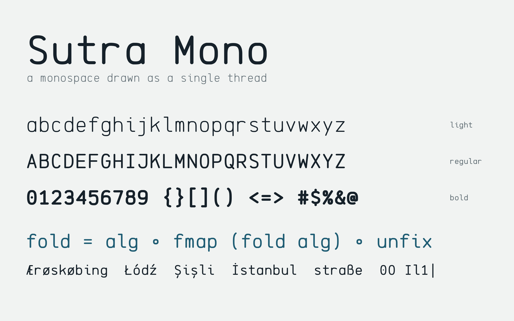
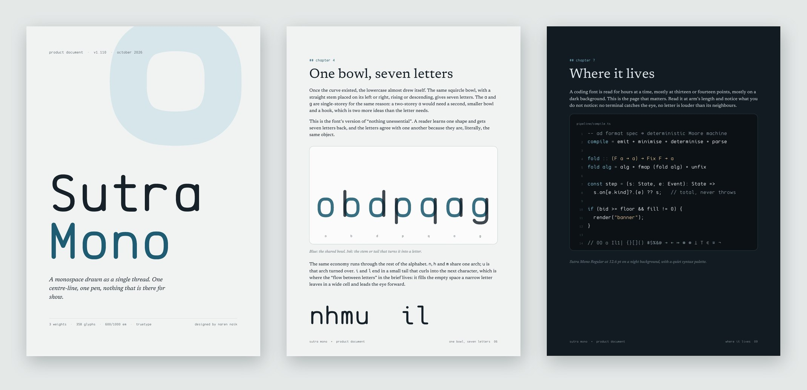
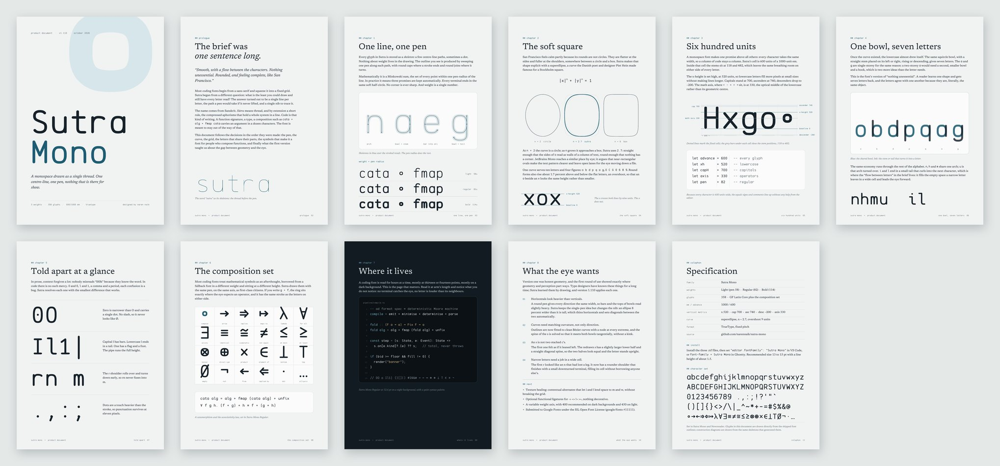
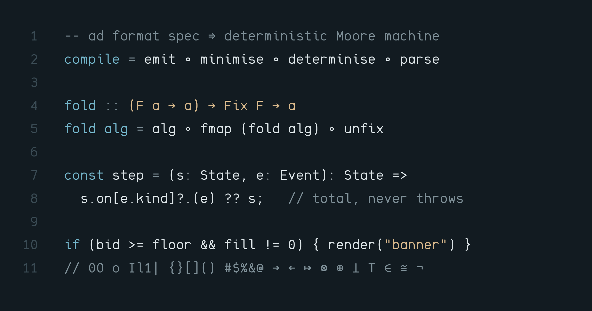

# Sutra Mono

**A typeface for code, drawn as a single thread.** One centre-line per letter, one pen to trace
it, nothing that is there for show.

**[Visit the specimen site →](https://narennaik.github.io/sutra-mono/)** · [Download the fonts](docs/SutraMono.zip) · [Read the design document (PDF)](documentation/design-doc/Sutra-Mono-Design-Document.pdf)



## The design document

[](documentation/design-doc/Sutra-Mono-Design-Document.pdf)

Eleven pages on how a one-sentence brief became a typeface: the single-pen idea, the soft-square
curve, the 600-unit grid, the bowl that seven letters share, the symbols for people who compose
functions, and the optical corrections that geometry alone gets wrong. Every glyph in it is drawn
from the font itself.

[](documentation/design-doc/Sutra-Mono-Design-Document.pdf)

## At a glance

- **Weights:** Light, Regular, Bold
- **Coverage:** GF Latin Core (Western, Central and South-East European Latin), plus a set of
  mathematical and functional-programming symbols: ∘ → ← ⇒ ⇐ ↦ λ ∀ ∃ ≡ ≠ ≅ ≤ ≥ ⊗ ⊕ × ∈ ⊥ ⊤ ∅ ¬
- **Told apart:** dotted `0`, barred `I`, tailed `l`, flagged `1`, heavier punctuation
- **Licence:** [SIL Open Font License 1.1](OFL.txt), free for any use, and
  [submitted to Google Fonts](https://github.com/google/fonts/issues/11111)



## Install

Download [`SutraMono.zip`](docs/SutraMono.zip) (or the `.ttf` files in
[`fonts/ttf`](fonts/ttf)), install them, then set your editor's font, for example
`"editor.fontFamily": "Sutra Mono"` in VS Code or `font-family = Sutra Mono` in Ghostty.

## How the font is made

The design lives in code. [`sources/generator/skeletons.py`](sources/generator/skeletons.py)
describes every glyph as centre-line paths on a 1000-unit em with a 600-unit advance.
[`geometry.py`](sources/generator/geometry.py) sweeps an elliptical pen along those paths and fits
the result to cubic Bézier contours with nodes at extrema, and
[`export.py`](sources/generator/export.py) writes one UFO per weight, with accented letters as
components and mark anchors for combining accents. The UFOs in [`sources`](sources) are committed
and are what `gftools builder` compiles.

## Build

Requires Python 3.10 or later.

```
make build    # regenerate the UFO sources, then build fonts/ttf
make test     # FontBakery, Google Fonts profile
make proof    # render documentation/specimen.png
make doc      # regenerate the design document PDF
make site     # refresh the specimen site in docs/
```

## Changelog

**1.110**: Respaced r (stem on the common stem line); s, S, $ and § redrawn as one smooth curve on an upright axis.

**1.100**: Elliptical pen (horizontals 8% lighter); redrawn s, S, $, r, ß; GF Latin Core coverage;
curve-fitted outlines; UFO sources and a gftools build; design document and specimen site.

**1.000**: First release.

## Licence

This Font Software is licensed under the SIL Open Font License, Version 1.1. The licence is copied
in [OFL.txt](OFL.txt) and is also available with a FAQ at https://openfontlicense.org.
